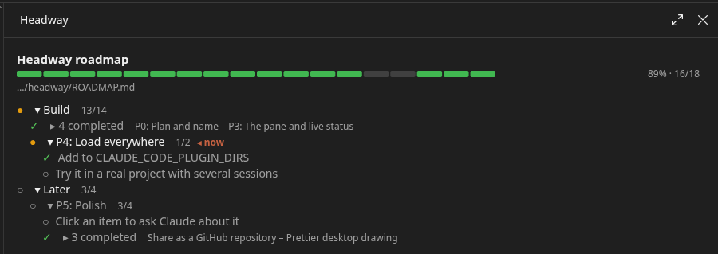
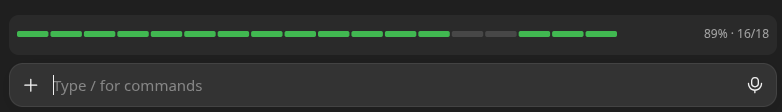

# Headway

A live roadmap pane for Claude Code. It shows how far along a project is, what's being worked on right now, and which session is on what.

The roadmap pane beside the chat:



And a progress bar just above the prompt box:



In the terminal, the progress bar is drawn as text.

## Install

### Let Claude do it

Paste this into a Claude Code session:

```text
Install the Headway plugin for Claude Code from https://github.com/imevul/claude-headway:

1. Install it at user scope: run `claude plugin install headway --marketplace imevul/claude-headway`
   in a shell, adding the marketplace if it asks.
2. Install its personal /headway command: copy `extras/headway.md` from the installed plugin
   (or from https://raw.githubusercontent.com/imevul/claude-headway/main/extras/headway.md)
   to `commands/headway.md` in my Claude config folder: `$CLAUDE_CONFIG_DIR` if that is set,
   otherwise `~/.claude`. Create the folder if needed. If a headway.md is already there,
   show me the difference and ask before replacing it.
3. Tell me what you installed and where, and that Headway loads in sessions started from now on.
```

The personal command is optional. It lets the desktop app recognise `/headway` from the first message of a new session; see [below](#headway-in-a-new-desktop-session).

### By hand

At the prompt of a terminal session:

```
/plugin install headway --marketplace imevul/claude-headway
```

From a shell:

```bash
claude plugin install headway --marketplace imevul/claude-headway
```

In the desktop app, where `/plugin` doesn't run:
1. Click **+** next to the prompt box, then **Plugins**.
2. Choose **Add marketplace** and enter `imevul/claude-headway`.
3. Choose **Add plugin**.

## How it works

- **The roadmap is a Markdown checklist in the repo.** Headway looks for it in `ROADMAP.md`, then `docs/ROADMAP.md`, then `docs/internal/ROADMAP.md`. File names match case-insensitively.
  - To use a different file in one project, put `{ "roadmap": "path/to/file.md" }` in `.headway/config.json`. The path can also be absolute.
  - To change the search list everywhere, set the **Roadmap search paths** option in a terminal's `/config`.
- **Status markers:**
  - `[ ]` todo
  - `[~]` in progress
  - `[x]` done
  - `[!]` blocked
  - `~~text~~` dropped

  Emoji also work (✅ ⬜ 🔁 ⬅️ 🚧 ❌), as do `DONE:` or `WIP:` prefixes.
- **Notes sections:** in a roadmap that uses markers, a heading whose whole section has none (say, "Known limitations") is treated as notes. It's shown dimmed and left out of the progress count.
- **Nesting:** `##`/`###` headings and indented items nest to any depth (slices → sprints → phases → tasks). A parent without a marker takes its status from its children.
- **Forgiving parser:** it accepts mixed bullets, tabs and odd indentation. It skips code blocks, front matter, comments and tables. Lines it can't understand are listed in the pane and never break it, as are things to check, like a section marked done that still has open items. Claude is told about those too, so it can raise them or fix them when it works on that part.
- **Live status:** each session writes `.headway/sessions/<id>.json`, which is git-ignored automatically.
  - The pane shows which session is on which item, and the step it's on. The step is mirrored from the session's task list.
  - Claude reports the item with the `mcp__headway__focus` tool. That tool also flips the item's marker in the file.
- **Expand/collapse:**
  - Items in progress and the current item are open. Done and future items are closed.
  - Click a row to toggle it. Your choice sticks until that item's status changes, so a section collapses by itself when it gets done.
  - Three or more done items in a row fold into one line.
- **Large roadmaps:** the header stays put and at most 18 rows show. The window follows the current item until you scroll away. It follows again when you scroll back to it, press **Jump to current**, or after a minute without scrolling.
- **Progress bar above the prompt:** a slim strip with the percentage done stays visible above the prompt box. Turn it off with `/headway band off`, or with the **Progress bar above the prompt** option in a terminal's `/config`.

## Terminal and desktop

Both work. In the desktop app the pane opens by itself when a roadmap is found. In the terminal you open it with `/headway`.

The pane docks beside the chat in the terminal's fullscreen layout at 110+ columns, and sits above the prompt otherwise.

## Commands

- `/headway`: open the pane.
- `/headway init`: ask Claude to draft a roadmap from the codebase, or to refresh an existing one.
- `/headway where`: show which file is used and the search order.
- `/headway band on|off`: show or hide the progress bar above the prompt.

### `/headway` in a new desktop session

Headway registers `/headway` when a session starts. The desktop app checks commands before that, so typing `/headway` as the first message of a new session shows "/headway isn't a command here". The command still runs.

To make the app know `/headway` from the start, copy [`extras/headway.md`](extras/headway.md) into your personal commands folder:

```bash
mkdir -p ~/.claude/commands && cp extras/headway.md ~/.claude/commands/
```

If you set `CLAUDE_CONFIG_DIR`, use that folder's `commands/` instead of `~/.claude/commands`. Headway answers the command itself, so the file's text only reaches Claude if Headway isn't loaded.

## Develop

To run Headway from a working copy, name its folder in `CLAUDE_CODE_PLUGIN_DIRS` in the `env` block of your Claude Code `settings.json`:

```json
{ "env": { "CLAUDE_CODE_PLUGIN_DIRS": "/path/to/claude-headway" } }
```

Then check it with:

```bash
claude plugin validate .
claude plugin test .
```

## License

Copyright 2026 [Imevul](https://github.com/imevul)

Licensed under the Apache License 2.0. See [LICENSE](LICENSE) and [NOTICE](NOTICE).
